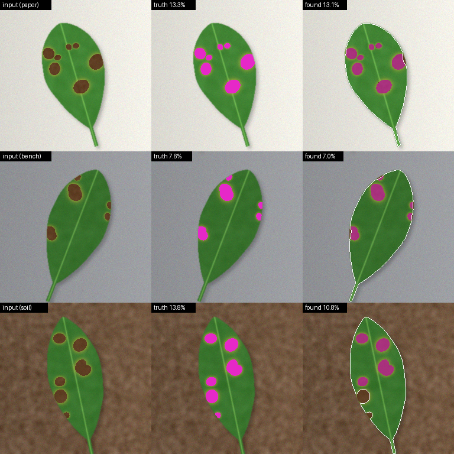
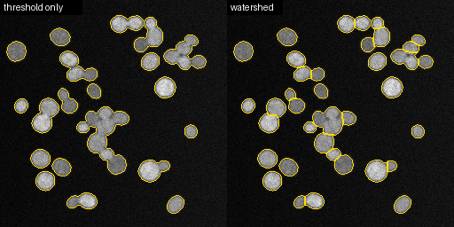
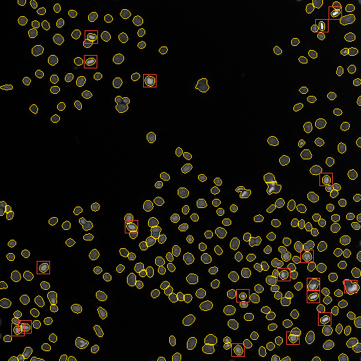

# plant-cell-image-analysis

[](https://github.com/liuweisu/plant-cell-image-analysis/actions/workflows/ci.yml)
**[Try it on your own leaf photo](https://liuweisu.github.io/plant-cell-image-analysis/)**

Classical image analysis for two everyday lab tasks:

- **Plant phenotyping:** segment leaves in photos, measure their shape, and score disease severity (the percentage of leaf area covered by lesions).
- **Fluorescence microscopy:** segment and count nuclei, including nuclei that touch, and flag unusually bright ones as candidate mitoses.

No deep learning here on purpose. These methods need no training data, run in milliseconds, and every step can be checked. They are also the baseline any learned model has to beat. Each method is measured on synthetic images with exact ground truth.



## How it works

**Leaves** ([`leaf.py`](src/bioimage/leaf.py))

1. Excess green index ExG = 2g - r - b on chromaticity coordinates separates plant tissue from paper, bench or soil and ignores overall brightness.
2. Otsu's threshold on ExG, a small opening, hole filling.
3. Lesions are not green, so a lesion on the leaf margin is cut out of the leaf mask, and the severity comes out too low. To fix this I close the mask with a large disk and keep the pixels this adds only if their colour (CIELAB) differs from the background colour at the image border.
4. Lesion pixels are leaf pixels with CIELAB a* > -2: healthy tissue sits around a* = -30 (green), necrotic tissue above 0 (brown). Yellow chlorotic halos stay below the threshold and count as leaf, as in visual scoring.
5. Per leaf: area, perimeter, length, width, aspect ratio, solidity, circularity, lesion count, severity.

**Nuclei** ([`nuclei.py`](src/bioimage/nuclei.py)): background subtraction, Otsu threshold, then a marker-controlled watershed on the distance transform so that touching nuclei are split along their neck.

## Results

From [`examples/benchmark_and_figures.py`](examples/benchmark_and_figures.py), on synthetic images with exact ground truth:

| Leaf background | Leaf IoU | Lesion IoU | Severity error (percentage points) | Without margin-lesion recovery |
| --- | --- | --- | --- | --- |
| White paper | 0.975 | 0.898 | 0.92 | 4.98 |
| Grey bench | 0.985 | 0.905 | 0.89 | 4.99 |
| Brown soil | 0.953 | 0.570 | 4.16 | 4.16 |

Recovering margin lesions cuts the severity error by a factor of five. On brown soil it does not help: brown lesions on the leaf edge have the same colour as the soil, so colour alone cannot tell where the leaf ends (bottom row of the figure above). Photograph leaves on a contrasting background, or use a model trained on leaf shapes.

| Nucleus counting (40 nuclei per image, IoU >= 0.5) | Precision | Recall | F1 | Count error |
| --- | --- | --- | --- | --- |
| Threshold + connected components | 0.82 | 0.49 | 0.61 | 16.2 |
| Distance-transform watershed | 0.99 | 0.97 | 0.98 | 0.8 |



On a real fluorescence image of human cells (`human_mitosis` from scikit-image's example data) the pipeline segments 311 nuclei and flags 19 unusually bright ones as candidate mitoses (red boxes). Brightness alone is a crude mitosis marker; a real screen would train a classifier on labelled cells.



## Use it

```bash
git clone https://github.com/liuweisu/plant-cell-image-analysis
cd plant-cell-image-analysis
pip install -e ".[dev]"

bioimage leaf photos/*.jpg --out leaves.csv --overlays checks/
bioimage nuclei images/*.tif --out nuclei.csv --overlays checks/
bioimage nuclei images/*.tif --no-watershed      # compare

python examples/benchmark_and_figures.py         # reproduce the tables and figures
pytest
```

Or from Python:

```python
from bioimage import leaf, nuclei
mask, lesions, measurements = leaf.analyse_leaf_image(rgb_array)
labels = nuclei.segment_nuclei(gray_array)
```

Always look at the overlay images before trusting the numbers.

## Browser demo

[`docs/index.html`](docs/index.html) is a dependency-free JavaScript port of the leaf pipeline (Otsu, chamfer-distance morphology, hole filling, connected components, sRGB to CIELAB). On the three sample images it gives the same severity as the Python version to within 0.4 percentage points.

## Layout

```
src/bioimage/      leaf.py, nuclei.py, metrics.py (IoU, Dice, instance F1), synthetic.py (images with ground truth), cli.py
tests/             accuracy tests against synthetic ground truth
examples/          benchmark script and its output
docs/              demo page, sample images and README figures
```

## License

MIT. The `human_mitosis` example image belongs to scikit-image's data collection and is downloaded at run time, not stored here.
